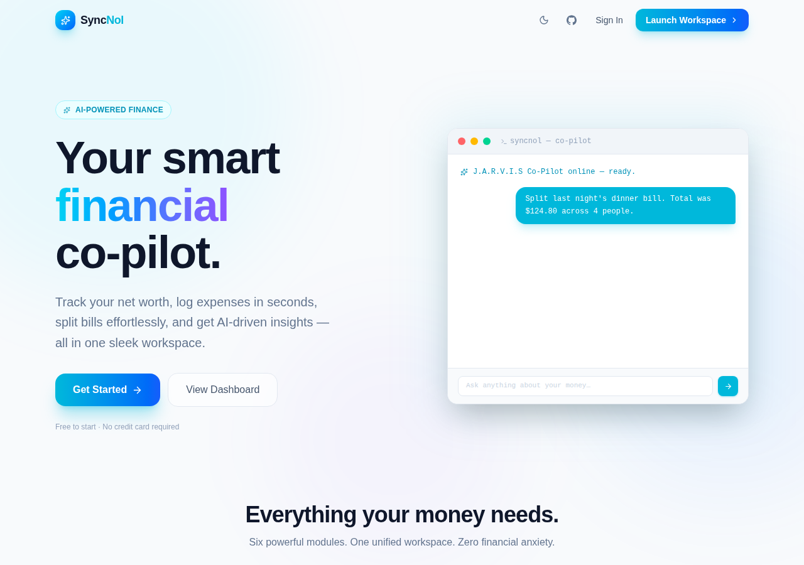
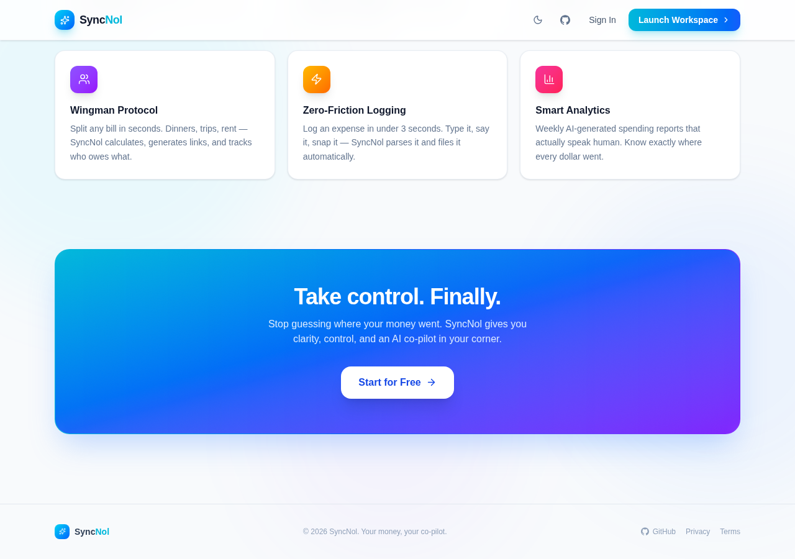
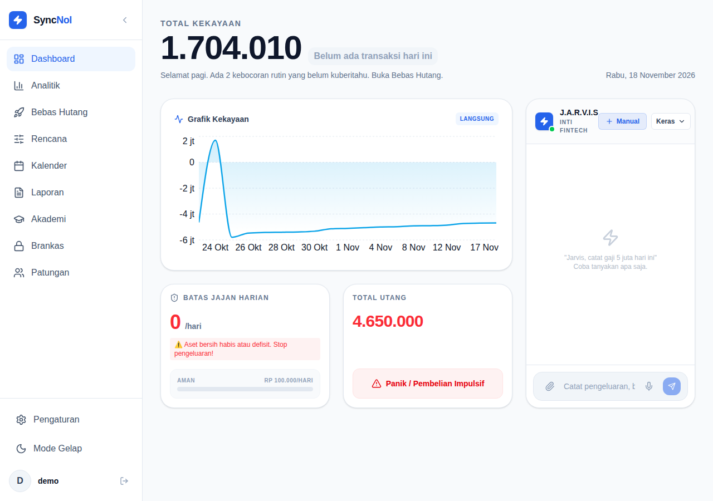
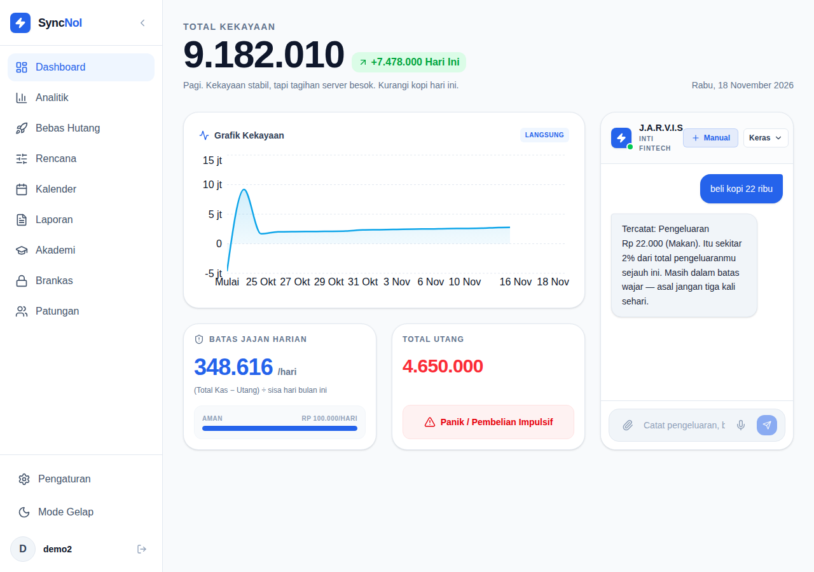
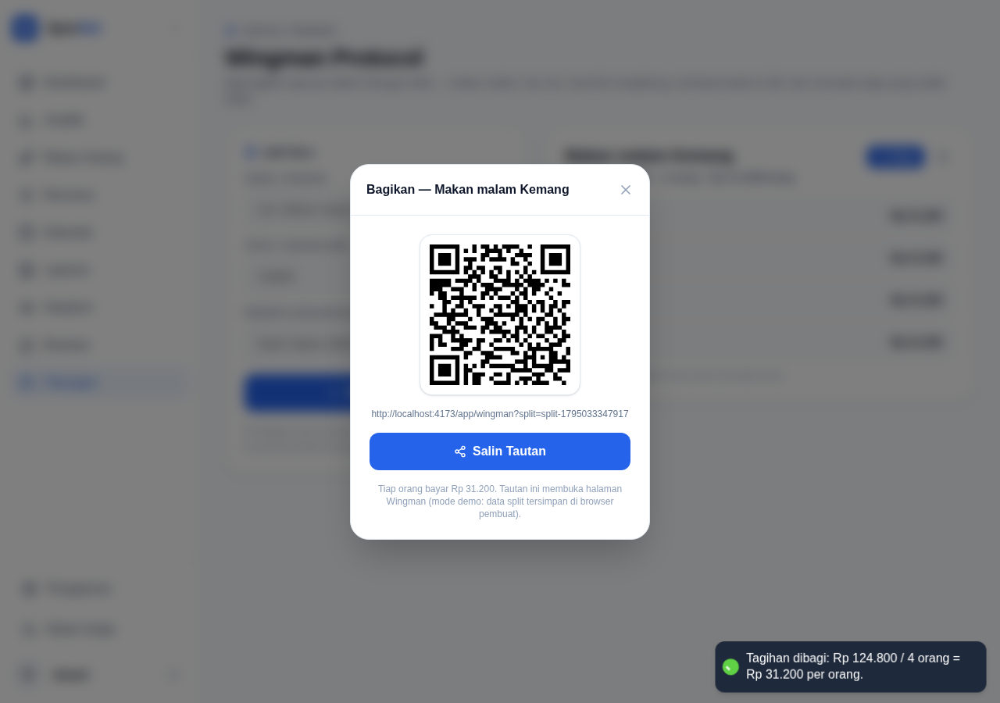
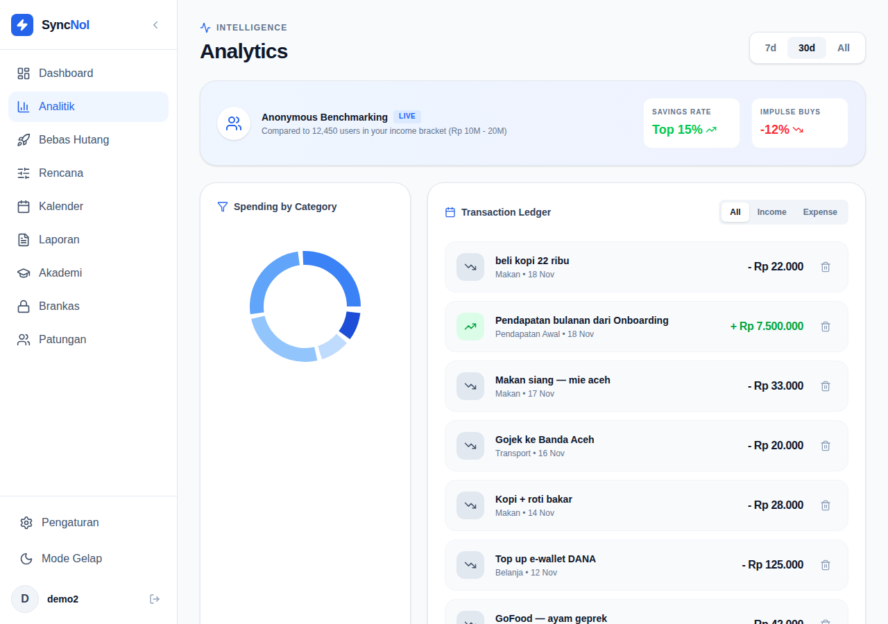
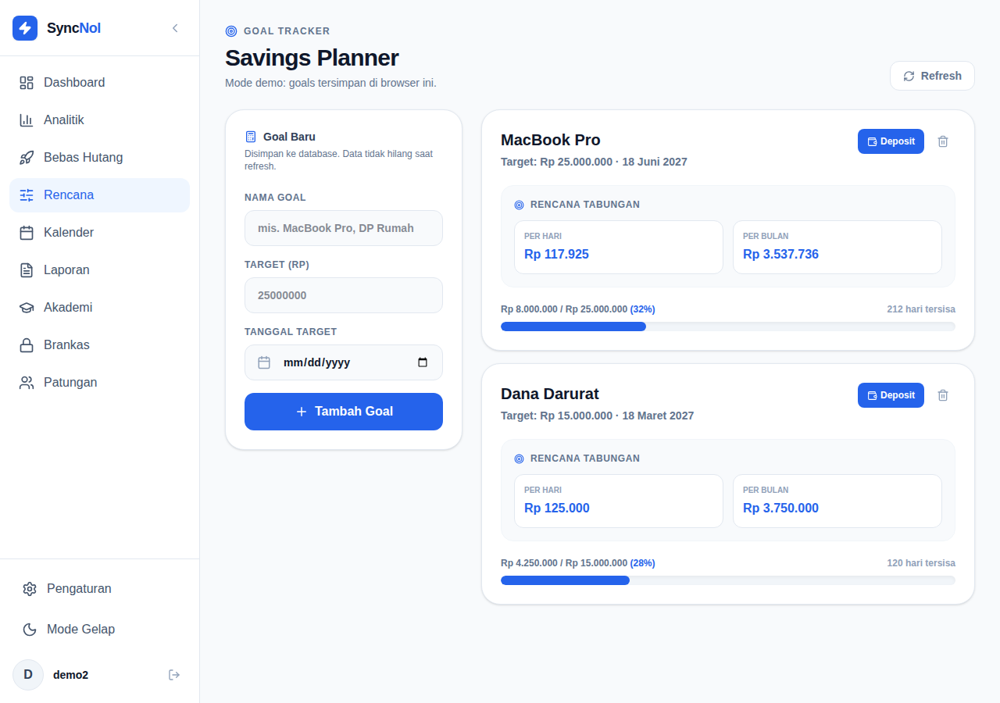

# SyncNol — Asisten Keuangan AI Berbahasa Indonesia

**Live:** https://syncnol.pages.dev · **Repo:** https://github.com/dezzorigin/syncnol

SyncNol adalah asisten keuangan pribadi berbahasa Indonesia dengan
co-pilot AI **J.A.R.V.I.S**: catat pengeluaran lewat chat ("beli kopi
22 ribu"), lihat kekayaan bersih, kelola utang, bagi tagihan bareng
teman (Wingman), dan tanya soal aturan OJK lewat RAG dari dokumen POJK
asli.



## Video demo

🎬 [Tonton video demo (MP4, 20 detik)](docs/demo/demo.mp4) — tur
landing → mode demo → dashboard → chat J.A.R.V.I.S → Wingman.

## Coba langsung (tanpa daftar)

1. Buka https://syncnol.pages.dev
2. Klik **Coba Mode Demo — tanpa daftar** (atau masuk dengan
   `demo@syncnol.id` / `demo1234`).
3. Di dashboard, ketik di chat J.A.R.V.I.S: `beli kopi 22 ribu` —
   transaksi tercatat sebagai Pengeluaran (Makan) Rp 22.000.
4. Buka **Patungan (Wingman)**: bagi tagihan Rp 124.800 berempat →
   Rp 31.200 per orang + QR bagikan.

Tanpa Supabase dan tanpa backend, aplikasi jalan penuh dalam **mode
demo** (data tersimpan di localStorage browser). Lihat
[docs/DEMO.md](docs/DEMO.md).

## Fitur

| Modul | Yang dilakukan |
|---|---|
| Dashboard | Kekayaan bersih, utang, grafik kekayaan, batas jajan harian |
| J.A.R.V.I.S | Chat keuangan: auto-journaling transaksi dari kalimat, tanya saldo/utang, OCR struk (butuh backend + Gemini) |
| Bebas Hutang | Daftar utang + Leakage Scanner (langganan bocor) |
| Rencana | Goals tabungan (Dana Darurat, MacBook Pro, …) |
| Kalender | Pengingat keuangan |
| Laporan | Ringkasan + ekspor PDF |
| Akademi | Modul literasi keuangan + XP |
| Brankas | Aset & catatan tersimpan |
| Patungan (Wingman) | Bagi tagihan rata + tautan & QR bagikan + lacak siapa sudah bayar |
| Admin Portal | Ringkasan pengguna (mode admin) |

## Arsitektur

```
Browser (React 19 + Vite + Tailwind 4)
   │  VITE_API_URL (opsional)        VITE_SUPABASE_URL (opsional)
   ├─► FastAPI backend ──► Postgres/SQLite + ChromaDB (RAG POJK)
   └─► Supabase Auth + tabel goals / academy_progress
   (tanpa keduanya: mode demo lokal — lihat docs/DEMO.md)
```

Detail: [docs/ARCHITECTURE.md](docs/ARCHITECTURE.md) ·
[docs/DIAGRAMS.html](docs/DIAGRAMS.html) (diagram HTML+SVG).

## Menjalankan lokal

### Frontend (mode demo — tanpa env apa pun)

```bash
cd frontend
npm ci
npm run dev        # http://127.0.0.1:5173
```

### Backend (FastAPI)

```bash
cd backend
python3 -m venv .venv && source .venv/bin/activate
pip install -r requirements.txt
cp .env.example .env   # isi GEMINI_API_KEY untuk fitur AI
uvicorn main:app --reload --port 8000
```

Tanpa `GEMINI_API_KEY`, server tetap boot; endpoint AI mengembalikan
error jelas (bukan 500). Tanpa `DATABASE_URL`, dipakai SQLite lokal
`./syncnol_local.db`.

### Tes

```bash
cd frontend
npm run lint                    # ESLint, 0 error
npm run test:e2e                # Playwright (mode demo)
cd ../backend
python3 -m unittest discover -s backend/tests -v   # dari root repo
```

## Tampilan

| Landing | Dashboard | Chat J.A.R.V.I.S |
|---|---|---|
|  |  |  |

| Wingman | Analitik | Rencana |
|---|---|---|
|  |  |  |

## Struktur repo

```
frontend/   Vite + React 19 + Tailwind 4 + Zustand (UI + mode demo)
backend/    FastAPI + SQLAlchemy (nudge/chat, CRUD, RAG POJK)
ai_engine/  Skrip coba Gemini / RAG (bukan bagian server)
docs/       PRD, arsitektur, API, demo, diagram, screenshot
scripts/    serve.mjs (server statis SPA) + advisory-sweep.py (OSV)
```

## Dokumen

- [PRD.md](PRD.md) — kebutuhan produk
- [docs/ARCHITECTURE.md](docs/ARCHITECTURE.md) — arsitektur & keputusan
- [docs/API.md](docs/API.md) — kontrak endpoint backend
- [docs/FRONTEND.md](docs/FRONTEND.md) — halaman & mode demo
- [docs/BACKEND.md](docs/BACKEND.md) — backend & RAG
- [docs/DEPLOYMENT.md](docs/DEPLOYMENT.md) — deploy Cloudflare Pages
- [docs/DEMO.md](docs/DEMO.md) — cara mencoba + bukti play-test
- [CHANGELOG.md](CHANGELOG.md) — riwayat perubahan

## Lisensi

MIT — lihat [LICENSE](LICENSE).
